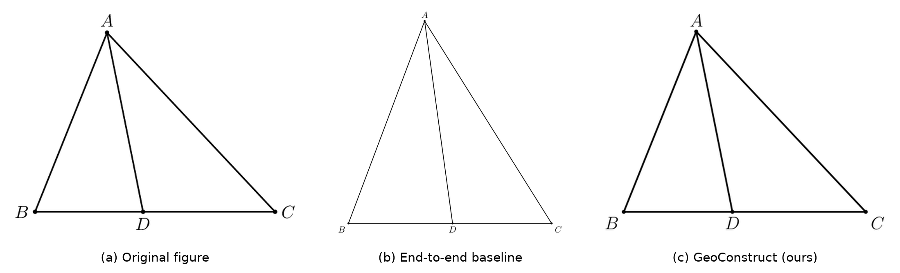
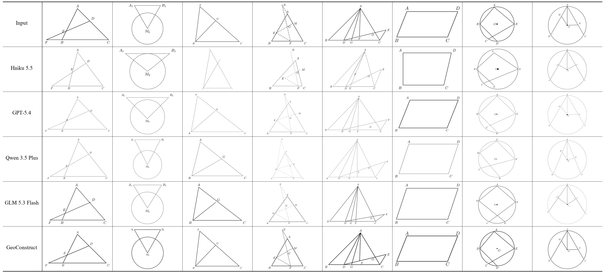
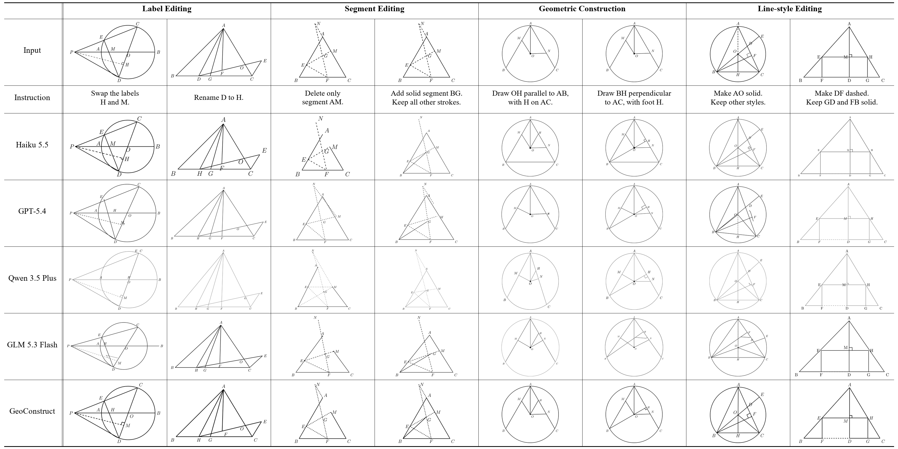

# Abstract

Converting raster geometric figures into executable code enables editing and reuse. Existing approaches, including end-to-end multimodal models, specialized models fine-tuned on large-scale datasets, and multi-agent systems with render-and-verify loops, primarily emphasize visual similarity. Small angular or segment-ratio deviations can change geometric relations while remaining difficult to detect with image-level metrics. We present **GeoConstruct**, a system for reconstructing geometric figures as editable, compilable TikZ code. We introduce a Geometric Evidence State (GES), a persistent structured record of geometric objects, relations, supporting measurements, and verification results, to organize reconstruction. A supervisor-worker architecture coordinates specialized agents and deterministic tools over this shared state. Point positions extracted from the input image ground code generation, geometric constraint repair applies bounded coordinate adjustments for selected candidate relations, and visual review guides further revisions. We also introduce a geometry-level evaluation protocol covering angle, segment-ratio, and point errors, among other metrics. Experiments on TriGeoBench show that **GeoConstruct** outperforms the evaluated baselines in both visual similarity and geometric fidelity, and that the recovered programs support local editing.

将栅格几何图形转换为可执行代码可支持图形编辑与复用。现有方法包括端到端多模态模型、在大规模数据上微调的专用模型，以及带有“渲染—验证”循环的多智能体系统，主要关注视觉相似性。细微的角度或线段比例偏差可能改变几何关系，却难以被图像级指标检测出来。我们提出 **GeoConstruct**，将几何图形还原为可编辑、可编译的 TikZ 代码。为组织重建过程，我们定义几何证据状态 GES，即持久化保存几何对象、关系、测量依据和验证结果的结构化记录。Supervisor-Worker 架构基于这一共享状态协调专用智能体与确定性工具。从原图提取的点位信息为代码生成提供依据，几何约束修复针对筛选出的候选几何关系执行受限坐标调整，视觉复核指导后续修订。我们还提出几何级评测协议，涵盖角度误差、线段比例误差与点位误差等多项指标。TriGeoBench 上的实验表明，**GeoConstruct** 在视觉相似性与几何保真度上均优于所评估的基线，还原程序能够支持局部编辑。

---

# I. Introduction

Geometric figures are widely used to illustrate mathematical concepts and relations in education. In textbooks, exercise books, and examination papers, however, they are almost always stored and presented as raster images. A raster figure can be displayed, but it cannot be edited. A teacher who wants to change a label, add an auxiliary point, or add or remove a segment must redraw the figure from scratch. Recovering the figure as executable code removes this barrier: once a figure exists as a parameterized program, it can be edited, restyled, re-rendered, and reused in new material. This paper studies the conversion of raster geometric figures into editable, compilable TikZ code.

Figure-to-code conversion requires preserving geometric relations as well as appearance. In Fig. 1, an end-to-end baseline produces a visually similar reconstruction, yet angle BAC is 52.56° rather than the reference 64.83°. These deviations can arise from errors when vision-language models estimate point coordinates from raster images: misplaced points change segment directions and angles even when the overall rendering remains similar. The resulting geometric errors can affect subsequent queries and edits, while image-level similarity metrics primarily assess appearance. We therefore target geometric fidelity alongside visual similarity.

Existing approaches leave this gap open. End-to-end multimodal large language models (MLLMs) generate TikZ in one shot [[1\]](https://arxiv.org/abs/2610.27626), [[2\]](https://arxiv.org/abs/2603.22687), but coordinate regression from pixels is imprecise and errors have no chance to be corrected. Models fine-tuned on large image-code corpora, such as FigCodifier [[4\]](https://arxiv.org/abs/2505.10557), MatPlotCode [[5\]](https://arxiv.org/abs/2510.11718), and GeoTikzBridge [[2\]](https://arxiv.org/abs/2603.22687), improve visual fidelity, yet their training and selection signals, CLIP-style image similarity, still measure appearance rather than geometric relations. Multi-agent systems, exemplified by Geo-Code [[3\]](https://arxiv.org/abs/2602.07749), iteratively refine their output through render-and-verify loops. In Geo-Code, the feedback is computed from pixel comparisons such as Chamfer and Hausdorff distances, and reconstruction also relies on paired textual geometric constraints. Our setting takes only the raster figure as input, requiring the system to recover geometric evidence directly from the image.

To this end, we present **GeoConstruct**, a system that treats figure-to-code conversion as evidence-driven reconstruction rather than one-shot generation. Its center is a persistent Geometric Evidence State (GES), a structured store in which every measurement, decision, and finding is recorded with provenance and confidence status. Over this shared state, a Supervisor dynamically orchestrates specialized sub-agents and deterministic tools: classical computer-vision (CV) operators supply pixel-level measurements of primitives and labels; a Geometry Agent consolidates fragmented measurements into geometric objects and relations; a Code Agent writes parameterized TikZ code on top of the measured coordinates, examines candidate constraints such as parallelism, perpendicularity, and collinearity against predefined tolerance thresholds, and proposes small coordinate corrections; and a Critic Agent compares each rendered version with the original figure and issues actionable revision requests. As shown in Fig. 1, the system uses CV measurements stored in the GES to guide code generation and visual feedback to refine point placement and connectivity. Consequently, **GeoConstruct** recovers angle BAC to its true 64.83°, using the same backbone model as the baseline.

Our contributions are as follows.

1) We propose **GeoConstruct**, a supervisor-worker architecture organized around a persistent Geometric Evidence State. All agents read from and write to one auditable state, which keeps measurements, decisions, and version history consistent across iterations.

2) We introduce a geometric constraint repair mechanism to reduce measurement deviations caused by pixel resolution, stroke width, and related factors. It treats near-satisfied parallel, perpendicular, and collinear relations as candidates and solves for minimal coordinate corrections while limiting point displacement and edge-length changes.

3) We define a geometry-level evaluation protocol covering angle, segment-ratio, and aligned point errors, among other metrics. On the TriGeoBench test set [[1\]](https://arxiv.org/abs/2610.27626), **GeoConstruct** substantially outperforms the evaluated baselines in both visual similarity and geometric fidelity, and the recovered programs directly support editing and reuse.

## 中文翻译

几何图形广泛用于数学教育，以呈现数学概念与关系。然而，在教材、练习册和试卷中，它们几乎总是以栅格图像的形式存储和展示。栅格图可以展示，却无法直接编辑。教师若要修改标签、添加辅助点或增删线段，往往需要重新绘制图形。将图形还原为可执行代码可以消除这一障碍：图形一旦表示为参数化程序，就能被编辑、调整样式、重新渲染并复用到新材料中。本文研究将栅格几何图形转换为可编辑、可编译的 TikZ 代码。

图形到代码的转换需要同时保留几何关系与外观。图 1 中，端到端基线生成的图形与原图外观相近，但角 BAC 为 52.56°，而参考值为 64.83°。这类偏差可能源于视觉语言模型对图像中点坐标的估计误差：点位偏移会改变线段方向与夹角，而整体外观仍可能相近。由此产生的几何误差会影响后续查询与编辑，图像级相似度指标则主要衡量外观。因此，我们将几何保真度与视觉相似性共同作为重建目标。

现有方法尚未解决这一问题。端到端多模态大语言模型 MLLM 一次性生成 TikZ [[1\]](https://arxiv.org/abs/2610.27626)、[[2\]](https://arxiv.org/abs/2603.22687)，但从像素回归坐标并不精确，生成后也缺少纠错机会。在大规模图像—代码语料上微调的模型，如 FigCodifier [[4\]](https://arxiv.org/abs/2505.10557)、MatPlotCode [[5\]](https://arxiv.org/abs/2510.11718) 和 GeoTikzBridge [[2\]](https://arxiv.org/abs/2603.22687)，能够提升视觉保真度，但其训练与筛选采用的 CLIP 式图像相似度信号，衡量的仍是外观而非几何关系。以 Geo-Code [[3\]](https://arxiv.org/abs/2602.07749) 为代表的多智能体系统通过“渲染—验证”循环逐步修订输出。其中，Geo-Code 的反馈由 Chamfer、Hausdorff 距离等像素比较计算，重建过程还依赖配套的文本几何约束。本文仅以栅格图像为输入，需要直接从图像中恢复几何证据。

我们提出 **GeoConstruct**，把图形到代码的转换视为证据驱动的重建，而非一次性生成。系统的中心是持久化的几何证据状态（GES），一个结构化存储，每条测量、决策与结论都带来源与置信状态记录在案。在这一共享状态之上，Supervisor 动态编排各专用子智能体与确定性工具：经典计算机视觉（CV）算子提供图元与标签的像素级测量；Geometry Agent 把碎片化的测量整合为几何对象与几何关系；Code Agent 在实测坐标之上编写参数化 TikZ 代码，并依据预设容差阈值检查平行、垂直、共线等候选约束，提出小幅坐标修正；Critic Agent 将每个渲染版本与原图比对，给出可执行的修改意见。如图 1 所示，系统基于 GES 中的 CV 测量结果生成代码，并通过视觉反馈逐步修正点位与连接偏差。因此，**GeoConstruct** 使用与该基线相同的骨干模型，将角 BAC 恢复到真实的 64.83°。

本文贡献如下：

1）我们提出 **GeoConstruct**，采用以持久化几何证据状态为中心的 Supervisor-Worker 架构。所有智能体读写同一份可审计的状态，使各轮迭代中的测量、判断与版本历史保持一致。

2）我们提出几何约束修复机制，以减小像素分辨率、笔画线宽等因素引起的测量偏差。该机制将接近满足的平行、垂直与共线关系作为候选，在限制点位移动与边长变化的条件下求解最小坐标修正。

3）我们定义几何级评测协议，涵盖角度误差、线段比例误差与对齐后点位误差等多项指标。在 TriGeoBench 测试集 [[1\]](https://arxiv.org/abs/2610.27626) 上，**GeoConstruct** 在视觉相似性与几何保真度上均显著优于所评估的基线，还原程序可直接支持编辑与复用。

---

# II. Related Work

## A. Image-to-Code Generation

Image-to-code generation translates raster images into executable programs. General-purpose MLLMs can already generate TikZ in one shot [[1\]](https://arxiv.org/abs/2610.27626), but regressing coordinates from pixels is imprecise and the errors go uncorrected. Fine-tuning on large image-code corpora improves visual fidelity [[6\]](https://arxiv.org/abs/2405.15306), [[4\]](https://arxiv.org/abs/2505.10557), [[5\]](https://arxiv.org/abs/2510.11718), [[2\]](https://arxiv.org/abs/2603.22687), yet these models still learn a pixel-to-code mapping whose training signals measure appearance rather than geometric relations. Multi-agent systems instead close the loop with render-and-verify feedback. Geo-Code [[3\]](https://arxiv.org/abs/2602.07749), the representative of this line, first anchors primitives at the pixel level and then iteratively refines the code under Chamfer- and Hausdorff-based feedback; however, the feedback still compares pixels rather than geometric relations, and the system relies on textual constraints paired with the image to resolve geometric ambiguities. Our task, in contrast, takes only the raster image as input, without any textual description of the construction.

## B. Geometric Image Editing

Geometric image editing modifies an existing figure, such as adding an auxiliary line or changing a label. Recent systems interleave such edits with the reasoning process [[7\]](https://arxiv.org/abs/2406.09403), [[8\]](https://arxiv.org/abs/2511.04460), [[9\]](https://arxiv.org/abs/2509.25866), [[10\]](https://arxiv.org/abs/2510.14958). Because edits are expressed most reliably as code, editing a raster figure first requires recovering it as a program, which makes image-to-code the enabling step for downstream editing.

## 中文翻译

**A. 图像到代码生成。** 图像到代码生成把栅格图像转换为可执行程序。通用 MLLM 已能一次性生成 TikZ [[1\]](https://arxiv.org/abs/2610.27626)，但从像素回归坐标并不精确，且错误没有机会被纠正。在大规模图像-代码语料上微调可以提升视觉保真度 [[6\]](https://arxiv.org/abs/2405.15306), [[4\]](https://arxiv.org/abs/2505.10557), [[5\]](https://arxiv.org/abs/2510.11718), [[2\]](https://arxiv.org/abs/2603.22687)，但这些模型学习的仍是像素到代码的映射，其训练与筛选信号衡量的是外观而非几何关系。多智能体系统则用反馈闭合环路。作为这一路线的代表，Geo-Code [[3\]](https://arxiv.org/abs/2602.07749) 先在像素级锚定图元，再在基于 Chamfer 与 Hausdorff 距离的"渲染-验证"反馈下迭代改进代码；然而其反馈比较的仍是像素而非几何关系，且系统依赖与图像配对的文本约束来消解几何歧义。相比之下，我们的任务只以栅格图像为输入，没有任何关于构造的文本描述。

**B. 几何图像编辑。** 几何图像编辑是对已有图形做修改，例如添加辅助线或更改标签。近期系统把这类编辑与推理过程交织进行 [[7\]](https://arxiv.org/abs/2406.09403), [[8\]](https://arxiv.org/abs/2511.04460), [[9\]](https://arxiv.org/abs/2509.25866), [[10\]](https://arxiv.org/abs/2510.14958)。由于编辑操作以代码形式表达最为可靠，编辑栅格图形的前提是先把图形还原为程序，图像到代码因此成为下游编辑应用的使能步骤。

---

# III. Method

## A. Overview

A reconstruction can resemble the input figure while differing in point positions, angles, or segment proportions. To reduce these deviations, **GeoConstruct** grounds code generation in image measurements and refines the result through geometric constraint repair and visual review. The system takes a raster figure as input and outputs editable, compilable, parameterized TikZ code.

Fig. 2 shows the overall architecture. A persistent Geometric Evidence State (GES) maintains consistent evidence across revisions. A supervisor-worker architecture coordinates specialized agents and deterministic tools over this shared state, with the Supervisor directing code generation and revision. Geometric constraint repair further applies bounded coordinate adjustments for selected candidate relations.

[此处插入系统架构图]

## B. Geometric Evidence State

Image measurement, geometric interpretation, and code revision require shared access to the geometric information recovered during reconstruction. The GES provides a persistent shared representation of the reconstruction, storing geometric objects and relations, supporting measurements, unresolved conflicts, and the code and verification results for each version. Each record retains its source and verification status, allowing agents to distinguish measured evidence from pending hypotheses. These records provide a shared basis for code generation and subsequent revisions. They are updated as new measurements and review findings become available, making geometric changes traceable.

## C. Supervisor-Worker Architecture

The supervisor-worker architecture uses the GES to coordinate specialized agents and deterministic tools for measurement, geometric interpretation, code generation, and review. CV tools extract line segments, curves, and label information from the input image. These detections may be fragmented or ambiguous, so the Geometry Agent consolidates them into a geometric skeleton that identifies labeled points, connections, line styles, and supported geometric relations.

The Code Agent generates parameterized TikZ code based on the geometric skeleton and the current geometric evidence. The system compiles and renders the code, then compares the connections encoded in the program with those in the geometric skeleton. The Critic Agent compares the rendering with the original figure and identifies discrepancies in geometry, connections, labels, and visual style. Its feedback specifies the affected elements and the required changes.

The Supervisor uses these findings to select the next action. It requests additional measurements when source evidence is insufficient, calls the Geometry Agent when the construction is uncertain, and directs the Code Agent to revise the program when the necessary changes are clear. New versions undergo the same checks and review. Based on the verification results and Critic reviews, the system selects the best candidate version as its final output.

## D. Geometric Constraint Repair

CV measurements are affected by pixel resolution, stroke width, and other rasterization effects. Small errors in the measured point positions and directions can therefore prevent the generated geometry from satisfying the intended relations. To reduce these deviations, **GeoConstruct** extracts point coordinates and segment connections from the generated TikZ code. It screens for near-satisfied parallel, perpendicular, and collinear relations and applies bounded adjustments to the associated points.

For a candidate relation $c$, let $u_{c}$ and $v_{c}$ denote the direction vectors of its two segments. For perpendicular relations, the normalized directional residual is

$$
\varepsilon_{c}=\frac{\lvert u_{c}\cdot v_{c}\rvert}{\lVert u_{c}\rVert\lVert v_{c}\rVert}, \qquad (1a)
$$

For parallel and collinear relations, we use

$$
\varepsilon_{c}=\frac{\lvert u_{c}\times v_{c}\rvert}{\lVert u_{c}\rVert\lVert v_{c}\rVert}, \qquad (1b)
$$

The system uses directional residuals to screen candidate relations. The default angular-deviation threshold for parallel and perpendicular candidates is 0.5°, restricting repair to near-satisfied relations. For a collinear candidate, the segments must also share a vertex, and the corresponding strokes in the input image must lie approximately on the same straight line. The repair jointly adjusts the point coordinates to satisfy the selected relations while limiting changes to the measured construction:

$$
\min_{P^{\prime}}\sum_{i}\lVert p_{i}^{\prime}-p_{i}\rVert_{2}^{2}, \quad \mathrm{s.t.}\quad \varepsilon_{c}(P^{\prime})=0\quad\forall c\in\mathcal{C}, \quad P^{\prime}\in\mathcal{S}(P), \qquad (2)
$$

Here, $P$ and $P^{\prime}$ denote the coordinates before and after repair, and $\mathcal{C}$ is the selected relation set. The admissible set $\mathcal{S}(P)$ limits point displacement and edge-length changes while preserving existing incidence relations, point order, and segment crossings. These restrictions keep the correction local to the existing construction.

The system compiles the repaired code and reads back point coordinates to verify that the selected relations hold, point displacement and edge-length changes remain within their limits, and the original point connections are preserved. If these checks fail, it retains the unrepaired code.

**中文翻译**

**A. 概述。** 重建结果即使与原图外观相近，仍可能出现点位偏移、角度偏差或线段比例失真。为减少这类偏差，**GeoConstruct** 以图像测量为依据生成代码，并通过几何约束修复与视觉复核改进重建结果。系统以栅格图像为输入，输出可编辑、可编译的参数化 TikZ 代码。

图 2 展示了系统的总体架构。持久化的几何证据状态 GES 在修订过程中维护一致的证据，Supervisor-Worker 架构基于这一共享状态协调各专用智能体与确定性工具，由 Supervisor 调度代码生成与修订。几何约束修复进一步针对筛选出的候选几何关系执行受限坐标调整。

**B. 几何证据状态。** 图像测量、几何理解与代码修订需要共享重建过程中获得的几何信息。GES 为重建过程提供持久化的共享表示，保存几何对象与关系、支撑它们的测量、尚未解决的冲突，以及各版代码与验证结果。每条记录均保留来源与验证状态，使智能体能够区分测量证据与待确认假设。这些记录为代码生成与后续修订提供共同依据，并随新增测量与复核结果更新，使几何调整可以追溯。

**C. Supervisor-Worker 架构。** Supervisor-Worker 架构基于 GES 协调各专用智能体与确定性工具，完成视觉测量、构造理解、代码生成与复核。CV 工具提取原图中的线段、曲线与标签信息。由于这些测量可能存在碎片或歧义，Geometry Agent 将其整合为几何骨架，明确带标签的点、连接、线型与有依据的几何关系。

Code Agent 以几何骨架和当前几何证据为依据生成参数化 TikZ 代码。系统编译并渲染代码，将代码中的点间连接与几何骨架进行比对。Critic Agent 随后对照原图检查几何、连接、标签和视觉样式上的差异，并给出指向具体元素的修改意见。

Supervisor 根据这些反馈选择后续操作：原图证据不足时补充测量，构造不明确时调用 Geometry Agent，所需修改已明确时则调度 Code Agent 修订程序。新版本继续接受相同的检查与复核。最终，系统根据验证结果与 Critic 评审，从候选版本中选择最优版本作为输出。

**D. 几何约束修复。** 受像素分辨率、笔画线宽等因素影响，CV 测得的点位与方向可能存在细微偏差，使生成坐标无法精确满足应有的几何关系。为减少这些偏差，**GeoConstruct** 从生成的 TikZ 代码中提取点坐标与线段连接，筛选接近平行、垂直或共线的候选关系，并对相关点位进行受限调整。

对于候选关系 $c$，记两条线段的方向向量为 $u_{c}$ 与 $v_{c}$。垂直关系与平行、共线关系的归一化方向残差分别按式 (1a)、(1b) 计算。系统根据方向残差筛选候选关系，平行与垂直候选的默认角度偏差阈值为 0.5°，使修复聚焦于接近满足的关系；共线候选还须共享顶点，且原图中的对应线条应近似位于同一直线上。随后，系统按式 (2) 联合调整点坐标，在满足选定关系的同时限制对原有构造的改动。其中，$P$ 与 $P^{\prime}$ 为修复前后的坐标，$\mathcal{C}$ 为选定的关系集合。可行域 $\mathcal{S}(P)$ 限制点位移与边长变化，并保留已有的点线关联、点序与线段交叉，使修复保持在原有构造的局部范围内。

系统编译修复后的代码，并回读点坐标，核查所选关系是否成立、点位移与边长变化是否超限，以及原有点间连接是否保留。检查未通过时保留修复前的代码。

---

# IV. Experiments

## A. Experimental Setup

We evaluate on plane geometry figures sampled from the TriGeoBench test split [[1\]](https://arxiv.org/abs/2610.27626). Four end-to-end MLLMs serve as baselines: haiku-5.5 [[14\]](https://www.anthropic.com/news/claude-haiku-5-5), gpt-5.4 [[15\]](https://deploymentsafety.openai.com/gpt-5-4-thinking), qwen3.5-plus [[16\]](https://qwen.ai/blog?id=qwen3.5), and glm-5.3-flash [[17\]](https://z.ai/blog/glm-5.3-flash), each generating TikZ from the image in one shot. We also include fine-tuned image-to-code models in the comparison: DeTikZify [[6\]](https://arxiv.org/abs/2405.15306), FigCodifier [[4\]](https://arxiv.org/abs/2505.10557), MatPlotCode [[5\]](https://arxiv.org/abs/2510.11718), and GeoTikzBridge [[2\]](https://arxiv.org/abs/2603.22687). All **GeoConstruct** agents use haiku-5.5 as their backbone. Its end-to-end output serves as a control for evaluating the performance gains of the proposed framework under the same backbone model. All methods are evaluated on the same figures under the same protocol.

## B. Evaluation Protocol and Metrics

**Visual similarity.** We compare rendered predictions with the input figures using SSIM [[11\]](https://ieeexplore.ieee.org/document/1284395) for structural similarity and cosine similarity between CLIP [[12\]](https://arxiv.org/abs/2103.00020) and DINOv2 [[13\]](https://arxiv.org/abs/2304.07193) features for perceptual similarity.

**Geometric fidelity.** Existing evaluations of this task focus on visual similarity and lack explicit assessment of geometric fidelity. We therefore design a geometry-level evaluation protocol that extracts geometric elements and relations from the reference code corresponding to each input figure. The reference code is used exclusively for evaluation and is not provided as input to the figure reconstruction process. We report angle mean absolute error and ratio mean relative error over items measurable by all compared methods:

$$
\mathrm{MAE}=\frac{1}{\lvert F\rvert}\sum_{f\in F}\frac{1}{\lvert A_f\rvert}\sum_{a\in A_f}\lvert\hat{\theta}_a-\theta_a\rvert, \qquad (3)
$$

$$
\mathrm{MRE}=\frac{1}{\lvert F\rvert}\sum_{f\in F}\frac{1}{\lvert R_f\rvert}\sum_{r\in R_f}\frac{\lvert\hat{r}_r-r_r\rvert}{r_r}, \qquad (4)
$$

Here, $F$ denotes the evaluated figures, and $A_{f}$ and $R_{f}$ denote the common measurable angle and ratio items in figure $f$. Hatted quantities are predictions; Unhatted quantities are reference values.

To assess structural completeness and overall shape, we also report segment F1 and aligned point error. Segment F1 is the harmonic mean of precision and recall over the predicted and reference segment sets. Point error is computed after translation, rotation, and uniform-scale alignment:

$$
\mathrm{PE}=\frac{1}{\lvert F\rvert}\sum_{f\in F}\frac{1}{N_f}\sum_{i=1}^{N_f}\min\left(1,\frac{d_{fi}}{D_f}\right), \qquad (5)
$$

Here, $N_{f}$ is the number of reference labeled points, $d_{fi}$ is the aligned distance of point $i$ to its reference, and $D_{f}$ is the reference figure's diameter.

The whole-figure pass rate jointly evaluates completeness and accuracy. A figure passes only if its code compiles, its labeled segment set matches the reference, and all reference angles and length ratios are measurable, with angular error at most 1° and relative ratio error at most 2%.

## C. Reconstruction Results

Table I reports the quantitative comparison. **GeoConstruct** achieves the best overall performance against both end-to-end MLLMs and fine-tuned image-to-code models, improving visual similarity and geometric fidelity.

**Table I. Reconstruction performance on TriGeoBench plane geometry figures.**

| Method | SSIM ×100 ↑ | CLIP ×100 ↑ | DINO ×100 ↑ | Angle MAE (°) ↓ | Ratio MRE (%) ↓ | Segment F1 (%) ↑ | Point error (%) ↓ | Pass rate (%) ↑ |
|---|---:|---:|---:|---:|---:|---:|---:|---:|
| haiku-5.5 | 90.5368 | 97.4663 | 96.8133 | 1.9586 | 5.4943 | 95.6761 | 1.8604 | 38.00 |
| gpt-5.4 | 90.5708 | 97.2459 | 96.2508 | 2.5393 | 7.4152 | 90.0352 | 2.3993 | 4.00 |
| qwen3.5-plus | 90.3925 | 96.8428 | 95.3246 | 5.7004 | 18.0126 | 96.4916 | 5.9289 | 4.00 |
| glm-5.3-flash | 90.2170 | 97.8734 | 97.0237 | 4.0074 | 16.0680 | 93.9367 | 3.4618 | 2.67 |
| DeTikZify [[6\]](https://arxiv.org/abs/2405.15306) | — | — | — | — | — | — | — | — |
| FigCodifier [[4\]](https://arxiv.org/abs/2505.10557) | — | — | — | — | — | — | — | — |
| MatPlotCode [[5\]](https://arxiv.org/abs/2510.11718) | — | — | — | — | — | — | — | — |
| GeoTikzBridge [[2\]](https://arxiv.org/abs/2603.22687) | — | — | — | — | — | — | — | — |
| **GeoConstruct (ours)** | **94.3554** | **99.3702** | **98.9812** | **0.1005** | **0.3156** | **99.9733** | **0.0935** | **86.00** |

Fig. 3 provides a qualitative comparison with the end-to-end baselines. Each column corresponds to the same input figure, with the original image in the top row and each method's rendering below. The baselines reproduce the overall appearance but can introduce displaced points, distorted segment proportions, or incorrect connections. **GeoConstruct** better preserves the geometric structure and relative layout of the input figures.

*Fig. 3. Qualitative reconstruction comparison. Each column shows the same input figure, with the original image above the renderings produced by the end-to-end baselines and **GeoConstruct**.*

## D. Ablation Study

We ablate geometric constraint repair and Critic feedback to assess their contributions. The repair ablation evaluates the same generated code with repair disabled. The Critic ablation uses the first valid version before review, retaining geometric constraint repair. Table II compares these variants with the full system and includes the shared-backbone end-to-end baseline for reference.

**Table II. Ablation of geometric constraint repair and Critic feedback.**

| Setting | SSIM ×100 ↑ | CLIP ×100 ↑ | DINO ×100 ↑ | Angle MAE (°) ↓ | Ratio MRE (%) ↓ | Segment F1 (%) ↑ | Point error (%) ↓ | Pass rate (%) ↑ |
|---|---:|---:|---:|---:|---:|---:|---:|---:|
| **GeoConstruct (full)** | **94.3554** | **99.3702** |     98.9812 |      **0.1005** |      **0.3156** |      **99.9733** |        **0.0935** |       **86.00** |
| w/o geometric constraint repair | 94.2784 | 99.3698 | **98.9869** | 0.1213 | 0.3885 | 99.8673 | 0.0991 | 83.33 |
| w/o Critic | 94.2453 | 99.2107 | 98.7866 | 0.2161 | 0.6463 | 99.4810 | 0.1826 | 80.67 |
| haiku-5.5 (end-to-end backbone) | 90.5368 | 97.4663 | 96.8133 |          1.9586 |          5.4943 | 95.6761 | 1.8604 | 38.00 |

Removing Critic feedback increases geometric errors and lowers the whole-figure pass rate, demonstrating the value of iterative visual review in identifying and correcting reconstruction errors. Disabling geometric constraint repair also increases geometric errors. These results support the complementary roles of visual feedback and geometric constraint repair. The comparison with the end-to-end haiku-5.5 baseline under the same backbone further supports the effectiveness of the proposed framework.

## E. Application to Figure Editing

Recovering executable code provides a geometric representation that supports subsequent figure editing. To examine this downstream use of the reconstructed programs, we evaluate label replacement and swapping, segment addition and deletion, parallel and perpendicular constructions, and local switching between solid and dashed lines. End-to-end baselines receive the original raster figure and the same editing instruction, then generate a complete TikZ program. **GeoConstruct** instead applies local edits to its recovered program, using the reconstructed point anchors to locate targets and compute new constructions. The resulting programs are compiled and rendered for comparison.

Fig. 4 presents qualitative examples across these edit types. **GeoConstruct** supports targeted changes while preserving the surrounding construction. The baseline examples illustrate errors such as omitted strokes, unintended additions, and incorrect local line styles, which can occur even when the requested target is modified.

*Fig. 4. Application to figure editing across label editing, segment editing, geometric construction, and line-style editing. Each example includes the input figure, editing instruction, and results from the end-to-end baselines and **GeoConstruct**.*

**中文翻译**

**A. 实验设置。** 我们从 TriGeoBench 测试划分 [[1\]](https://arxiv.org/abs/2610.27626) 中抽取数学平面几何图形进行评测。四个端到端 MLLM 作为基线：haiku-5.5 [[14\]](https://www.anthropic.com/news/claude-haiku-5-5)、gpt-5.4 [[15\]](https://deploymentsafety.openai.com/gpt-5-4-thinking)、qwen3.5-plus [[16\]](https://qwen.ai/blog?id=qwen3.5) 与 glm-5.3-flash [[17\]](https://z.ai/blog/glm-5.3-flash)，均从图像一次性生成 TikZ；并与经微调的图像到代码模型 DeTikZify [[6\]](https://arxiv.org/abs/2405.15306)、FigCodifier [[4\]](https://arxiv.org/abs/2505.10557)、MatPlotCode [[5\]](https://arxiv.org/abs/2510.11718) 和 GeoTikzBridge [[2\]](https://arxiv.org/abs/2603.22687) 比较。**GeoConstruct** 的所有智能体均采用 haiku-5.5 作为骨干模型，并以该模型的端到端输出作为对照，以在相同骨干模型条件下评估所提框架带来的性能增益。所有方法在同一批图形、同一协议下评测。

**B. 评测协议与指标。** 我们从视觉相似性与几何保真度两个方面评估重建质量。视觉相似性采用 SSIM [[11\]](https://ieeexplore.ieee.org/document/1284395) 衡量结构一致性，并采用 CLIP [[12\]](https://arxiv.org/abs/2103.00020) 与 DINOv2 [[13\]](https://arxiv.org/abs/2304.07193) 特征的余弦相似度衡量感知相似性。

现有同类任务的评测主要关注视觉相似性，尚缺乏对几何保真度的显式评估。为此，我们设计了几何级评测协议，从原图对应的参考代码中提取几何元素与几何关系，作为评价重建结果的依据。参考代码仅用于评测，不作为图形重建过程的输入。我们采用角度平均绝对误差 MAE 与比例平均相对误差 MRE，分别按式 (3)、(4) 计算各对比方法共同可测项上的误差。其中，$F$ 为评测图形集合，$A_{f}$ 与 $R_{f}$ 分别为图 $f$ 的共同可测角度项与比例项，带帽符号表示预测值，其余表示参考值。

我们进一步采用线段 F1 和对齐后点位误差衡量结构完整性与整体形状。线段 F1 为预测与参考线段集合匹配的精确率和召回率的调和平均。点位误差按式 (5) 计算：先通过平移、旋转与等比缩放对齐同名点，再以参考图形的直径归一化点间距离。其中，$N_{f}$ 为参考带标签点数，$d_{fi}$ 为点 $i$ 对齐后到参考位置的距离，$D_{f}$ 为参考图形的直径。

整图通过率综合衡量完整性与准确性。仅当代码成功编译、带标签的线段集合与参考一致，且所有参考角度与长度比均可测、角度误差不超过 1°、比例相对误差不超过 2% 时，图形才被判定为通过。

**C. 重建结果。** 表 I 汇总了定量对比结果。相较于端到端 MLLM 与经微调的图像到代码模型，**GeoConstruct** 取得了最佳的整体表现，视觉相似性与几何保真度均得到提升。

图 3 展示了 **GeoConstruct** 与端到端基线的重建结果对照。每列对应同一输入图形，首行为原图，其余行为各方法的渲染结果。基线能够复现整体外观，但仍可能出现点位偏移、线段比例失真或连接关系错误；**GeoConstruct** 则更好地保持了原图的几何结构与相对布局。图像见英文部分。

**D. 消融实验。** 我们分别移除几何约束修复与 Critic 反馈，以评估其贡献。几何约束修复消融在同一份生成代码上停用修复阶段；Critic 消融采用首次评审前的有效版本，并保留几何约束修复。表 II 比较了完整系统与消融变体，同时列出采用相同骨干模型的端到端基线作为参考。

移除 Critic 反馈后，几何误差增大，整图通过率下降，说明迭代视觉复核有助于发现并纠正重建偏差。关闭几何约束修复同样导致几何误差增大。两项消融共同表明，视觉反馈与几何约束修复具有互补作用。与采用相同骨干模型的端到端 haiku-5.5 基线的对比，进一步支持了所提框架的有效性。

**E. 图形编辑应用。** 将栅格图形还原为可执行代码，为基于几何对象与关系的局部编辑提供了基础。为考察重建结果对下游图形编辑的支持，我们进一步开展标签替换与交换、线段增删、平行与垂直构造，以及局部实虚线切换实验。端到端基线接收原始栅格图与相同的编辑指令，重新生成完整的 TikZ 程序；**GeoConstruct** 则在已有重建程序上执行局部编辑，利用重建点的坐标定位目标并计算新增构造。各方法的输出均经编译和渲染后进行对比。

图 4 展示了各类编辑的定性案例。**GeoConstruct** 能够在保留周边构造的同时完成目标修改。基线案例则呈现出笔画遗漏、额外添加图元及局部线型修改不正确等问题，说明即使目标操作已经执行，图形的其他部分仍可能发生变化。

---

# V. Conclusion

We presented **GeoConstruct**, a system that converts raster geometric figures into editable, compilable TikZ code. Its design rests on three components: a persistent Geometric Evidence State that records the provenance of every measurement and decision; a supervisor-worker architecture in which the Supervisor orchestrates CV tools and specialized agents over this shared state; and a geometric constraint repair mechanism that applies minimal coordinate adjustments for selected parallel, perpendicular, and collinear candidates while limiting point displacement and edge-length changes. On the TriGeoBench test set [[1\]](https://arxiv.org/abs/2610.27626), **GeoConstruct** outperforms the evaluated baselines in both visual similarity and geometric fidelity, and the recovered programs support local editing and reuse.

## 中文翻译

我们提出了 **GeoConstruct**，一个把栅格几何图形转换为可编辑、可编译 TikZ 代码的系统。其设计基于三部分：持久化的几何证据状态（GES），记录每条测量与决策的来源；Supervisor-Worker 架构，由 Supervisor 在该状态之上统一编排 CV 工具与专用智能体；以及几何约束修复机制，它针对筛选出的平行、垂直与共线候选关系，在限制点位移动与边长变化的条件下执行最小坐标修正。在 TriGeoBench 测试集 [[1\]](https://arxiv.org/abs/2610.27626) 上，**GeoConstruct** 在视觉相似性与几何保真度两方面均优于所评估的基线，且还原出的程序支持局部编辑与复用。

---

# References

[1] J. Wang, Y. Yang, H. Dou, Y. Wu, S. He, T. Shen, J. Wu, J. Li, and Y. Wang, "TriGeoBench: A multimodal mathematical geometry benchmark with figures and TikZ," arXiv:2610.27626, 2026. [Online]. Available: https://arxiv.org/abs/2610.27626

[2] J. Sun, C. Sun, B. Yang, H. Li, X. Chen, Y. Zhang, E. Ding, L. Li, C. Deng, and J. Feng, "GeoTikzBridge: Advancing multimodal code generation for geometric perception and reasoning," arXiv:2603.22687, 2026. [Online]. Available: https://arxiv.org/abs/2603.22687

[3] Z. Wu, Y. Long, J. Li, and H. Huang, "Geo-Code: A code framework for reverse code generation from geometric images based on two-stage multi-agent evolution," arXiv:2602.07749, 2026. [Online]. Available: https://arxiv.org/abs/2602.07749

[4] K. Wang, J. Pan, L. Wei, A. Zhou, W. Shi, Z. Lu, H. Xiao, Y. Yang, H. Ren, M. Zhan, and H. Li, "MathCoder-VL: Bridging vision and code for enhanced multimodal mathematical reasoning," in Findings of the Assoc. Comput. Linguistics (ACL), 2025. [Online]. Available: https://arxiv.org/abs/2505.10557

[5] C. Duan, K. Sun, R. Fang, M. Zhang, Y. Feng, Y. Luo, Y. Liu, K. Wang, P. Pei, X. Cai, H. Li, Y. Ma, and X. Liu, "CodePlot-CoT: Mathematical visual reasoning by thinking with code-driven images," arXiv:2510.11718, 2025. [Online]. Available: https://arxiv.org/abs/2510.11718

[6] J. Belouadi, S. P. Ponzetto, and S. Eger, "DeTikZify: Synthesizing graphics programs for scientific figures and sketches with TikZ," in Proc. Adv. Neural Inf. Process. Syst. (NeurIPS), 2024. [Online]. Available: https://arxiv.org/abs/2405.15306

[7] Y. Hu, W. Shi, X. Fu, D. Roth, M. Ostendorf, L. Zettlemoyer, N. A. Smith, and R. Krishna, "Visual Sketchpad: Sketching as a visual chain of thought for multimodal language models," in Proc. Adv. Neural Inf. Process. Syst. (NeurIPS), 2024. [Online]. Available: https://arxiv.org/abs/2406.09403

[8] R. Qiao, Q. Tan, M. Yang, G. Dong, P. Yang, S. Lang, E. Wan, X. Wang, Y. Xu, L. Yang, et al., "V-Thinker: Interactive thinking with images," arXiv:2511.04460, 2025. [Online]. Available: https://arxiv.org/abs/2511.04460

[9] C. Zhang, H. Qiu, Q. Zhang, Z. Zeng, L. Ma, and J. Zhang, "DeepSketcher: Internalizing visual manipulation for multimodal reasoning," arXiv:2509.25866, 2025. [Online]. Available: https://arxiv.org/abs/2509.25866

[10] W. Shi, A. Yu, R. Fang, H. Ren, K. Wang, A. Zhou, C. Tian, X. Fu, Y. Hu, Z. Lu, L. Huang, S. Liu, R. Liu, and H. Li, "MathCanvas: Intrinsic visual chain-of-thought for multimodal mathematical reasoning," arXiv:2510.14958, 2025. [Online]. Available: https://arxiv.org/abs/2510.14958

[11] Z. Wang, A. C. Bovik, H. R. Sheikh, and E. P. Simoncelli, "Image quality assessment: From error visibility to structural similarity," IEEE Trans. Image Process., vol. 13, no. 4, pp. 600-612, Apr. 2004. [Online]. Available: https://ieeexplore.ieee.org/document/1284395

[12] A. Radford, J. W. Kim, C. Hallacy, A. Ramesh, G. Goh, S. Agarwal, G. Sastry, A. Askell, P. Mishkin, J. Clark, G. Krueger, and I. Sutskever, "Learning transferable visual models from natural language supervision," in Proc. Int. Conf. Mach. Learn. (ICML), 2021, pp. 8748-8763. [Online]. Available: https://arxiv.org/abs/2103.00020

[13] M. Oquab, T. Darcet, T. Moutakanni, H. Vo, M. Szafraniec, V. Khalidov, P. Fernandez, D. Haziza, F. Massa, A. El-Nouby, et al., "DINOv2: Learning robust visual features without supervision," Trans. Mach. Learn. Res. (TMLR), 2024. [Online]. Available: https://arxiv.org/abs/2304.07193

[14] Anthropic, "Introducing Claude Haiku 5.5," Oct. 2026. [Online]. Available: https://www.anthropic.com/news/claude-haiku-5-5

[15] OpenAI, "GPT-5.4 Thinking system card," Mar. 2026. [Online]. Available: https://deploymentsafety.openai.com/gpt-5-4-thinking

[16] Qwen Team, Alibaba Group, "Qwen3.5," Feb. 2026. [Online]. Available: https://qwen.ai/blog?id=qwen3.5

[17] Z.ai, "GLM-5.3-Flash," Aug. 2026. [Online]. Available: https://z.ai/blog/glm-5.3-flash
