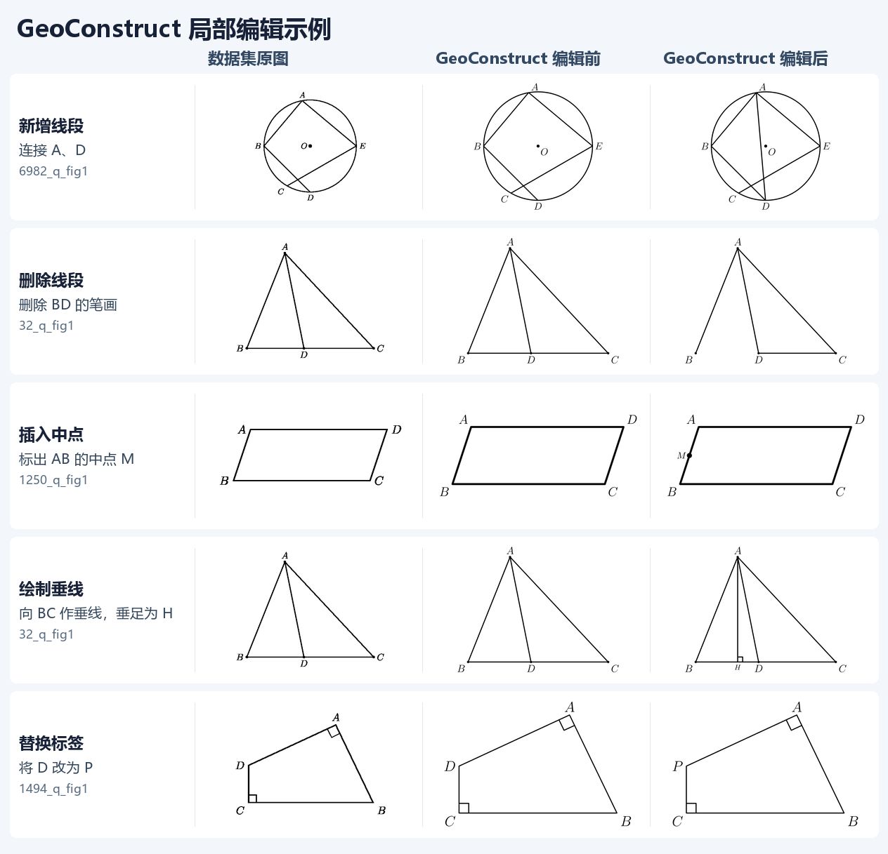

# GeoConstruct 局部编辑示例

五条指令分别作用于 `outputs/ours/latex` 中已经生成的 TikZ。每例都保存了数据集原图 `original.png`、编辑前后的 TikZ、PDF、PNG，以及编译和几何检查记录 `edited.json`。



[查看同一批案例的四个 e2e 模型对比](e2e/README.md)

[查看与 Haiku 5.5 的 16 个扩展案例](haiku_extended/README.md)

[查看指定子段变虚线的六个单步案例](haiku_local_style/README.md)

| 操作 | 指令 | 源图 | 输出 |
|---|---|---|---|
| 新增线段 | 连接点 A 和点 D，画出实线线段 AD。 | `6982_q_fig1` | [编辑图](01-add-segment/edited.png) · [核验](01-add-segment/edited.json) |
| 删除线段 | 删除线段 BD 的笔画，保留点 B、点 D 及其标签。 | `32_q_fig1` | [编辑图](02-delete-segment/edited.png) · [核验](02-delete-segment/edited.json) |
| 插入中点 | 在线段 AB 的中点添加一个实心点，并标记为 M。 | `1250_q_fig1` | [编辑图](03-midpoint/edited.png) · [核验](03-midpoint/edited.json) |
| 绘制垂线 | 从点 A 向线段 BC 作垂线，画出线段 AH，把垂足标记为 H，并在 H 处标出直角。 | `32_q_fig1` | [编辑图](04-perpendicular/edited.png) · [核验](04-perpendicular/edited.json) |
| 替换标签 | 把点 D 的标签改为 P，保留该点的位置和与它相连的线段。 | `1494_q_fig1` | [编辑图](05-rename-label/edited.png) · [核验](05-rename-label/edited.json) |

从项目根目录运行以下命令可以复现垂线示例。每次运行请选择一个新输出路径。编辑器支持上表中的中文句式，也支持操作名和点名参数。

```powershell
python scripts/edit_geometry.py outputs/ours/latex/32_q_fig1.tex --instruction "从点 A 向线段 BC 作垂线，画出线段 AH，把垂足标记为 H，并在 H 处标出直角。" --label-placement below --out outputs/ah_example.tex --report
```
