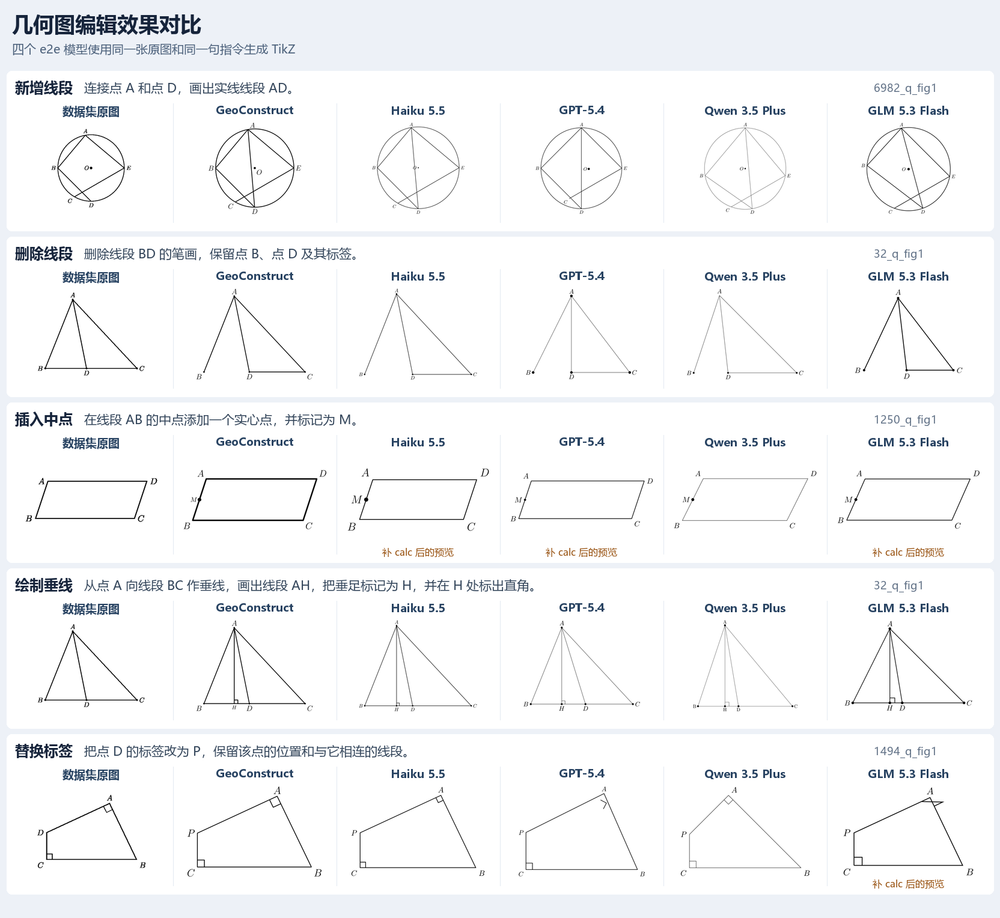

# 几何图编辑对比

Haiku 5.5、GPT-5.4、Qwen 3.5 Plus 和 GLM 5.3 Flash 分别收到同一案例的[数据集原图和中文指令](../README.md)，直接生成编辑后的完整 TikZ。GeoConstruct 读取该原图先前生成的 TikZ 并执行相同指令。统一提示词见 [prompt.txt](prompt.txt)。

| 案例 | GeoConstruct | Haiku 5.5 | GPT-5.4 | Qwen 3.5 Plus | GLM 5.3 Flash |
|---|---|---|---|---|---|
| 新增 AD | [图](../01-add-segment/edited.png) | [图](01-add-segment/haiku-5.5/edited.png) | [图](01-add-segment/gpt-5.4/edited.png) | [图](01-add-segment/qwen3.5-plus/edited.png) | [图](01-add-segment/glm-5.3-flash/edited.png) |
| 删除 BD | [图](../02-delete-segment/edited.png) | [图](02-delete-segment/haiku-5.5/edited.png) | [图](02-delete-segment/gpt-5.4/edited.png) | [图](02-delete-segment/qwen3.5-plus/edited.png) | [图](02-delete-segment/glm-5.3-flash/edited.png) |
| 插入中点 M | [图](../03-midpoint/edited.png) | [补库预览](03-midpoint/haiku-5.5/preview.png) | [补库预览](03-midpoint/gpt-5.4/preview.png) | [图](03-midpoint/qwen3.5-plus/edited.png) | [补库预览](03-midpoint/glm-5.3-flash/preview.png) |
| 作垂线 AH | [图](../04-perpendicular/edited.png) | [图](04-perpendicular/haiku-5.5/edited.png) | [图](04-perpendicular/gpt-5.4/edited.png) | [图](04-perpendicular/qwen3.5-plus/edited.png) | [图](04-perpendicular/glm-5.3-flash/edited.png) |
| 将 D 改为 P | [图](../05-rename-label/edited.png) | [图](05-rename-label/haiku-5.5/edited.png) | [图](05-rename-label/gpt-5.4/edited.png) | [图](05-rename-label/qwen3.5-plus/edited.png) | [补库预览](05-rename-label/glm-5.3-flash/preview.png) |

20 份模型输出中有 16 份直接编译，另外 4 份缺少 `\usetikzlibrary{calc}`。这 4 份在补上该声明后均已渲染。每个模型目录中的 `edited.tex` 保存模型返回的代码，`run.json` 记录请求尝试与编译状态，`preview.tex` 和 `preview.png` 保存补库后的版本。Qwen 的新增线段和改标签经过流式重试后返回了完整结果。

- 删除 BD 的案例中，GPT-5.4 保留了 B、D 的标签，但把倾斜的 AD 画成了竖线。[GPT-5.4 删除结果](02-delete-segment/gpt-5.4/edited.png)
- 改标签的案例中，GPT-5.4 和 GLM 的 A 点直角标记偏离了原有角的两条边。GLM 的问题在补库预览中也可见。[GPT-5.4 改名结果](05-rename-label/gpt-5.4/edited.png) · [GLM 改名预览](05-rename-label/glm-5.3-flash/preview.png)
- 作垂线的案例中，四个 e2e 模型都画出了 AH、H 标签和直角标记。[垂线对比](comparison.png)
