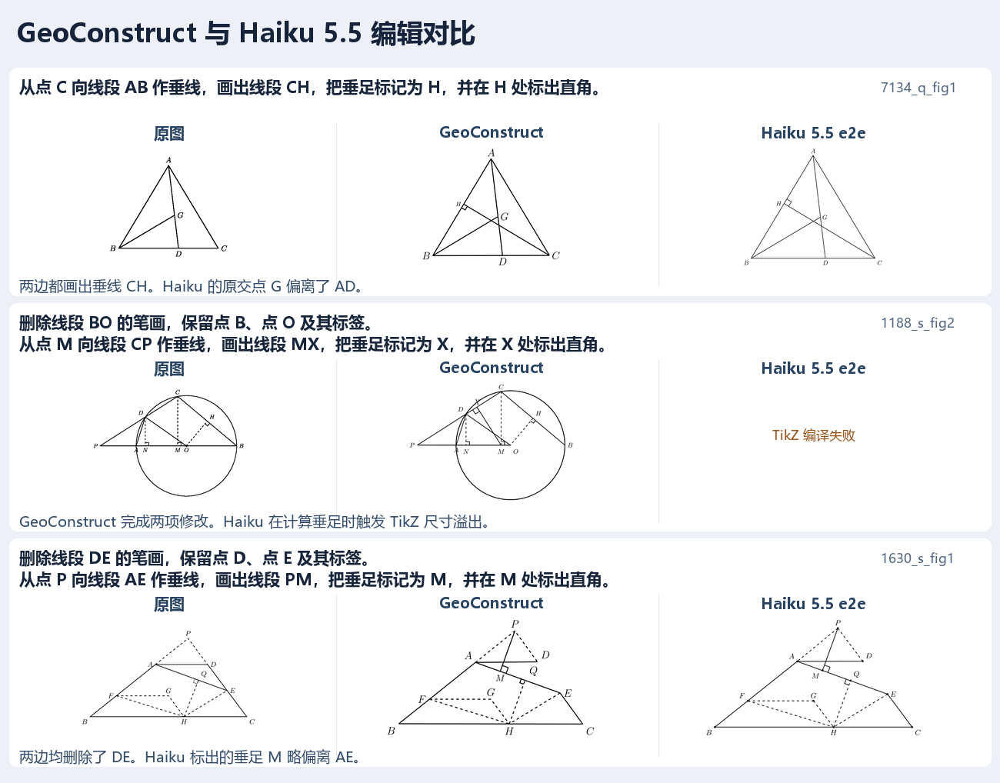

# GeoConstruct 与 Haiku 5.5 的扩展编辑对比

两种方法在同一批 16 个新案例上执行相同指令。GeoConstruct 复用该图的归档 TikZ。Haiku 5.5 收到数据集原图和同样的指令，直接输出编辑后的完整 TikZ。每组保存原图、输出代码、渲染图和运行记录。

| 案例 | 数量 | 完整对照 |
|---|---:|---|
| 带直角标记的点改名 | 4 | [对照图](rename.png) |
| 删除连续直线中的指定线段 | 4 | [对照图](delete-segment.png) |
| 向斜线段作垂线 | 4 | [对照图](perpendicular.png) |
| 同一张图删边并添加垂线 | 4 | [对照图](compound.png) |

单步案例根据参考几何筛选，排除已有展示用图，每类按固定哈希选 4 张。组合案例排除前 12 张，在通过两种操作前置条件的图里按参考具名边数排序，取前 4 张。两批任务均在生成前冻结。[单步任务](tasks.json) · [组合任务](compound/tasks.json) · [统一提示词](prompt.txt)

| 这批案例的检查结果 | GeoConstruct | Haiku 5.5 e2e |
|---|---:|---:|
| 单步任务通过目标检查 | 11/12 | 11/12 |
| 单步任务同时通过目标和保留检查 | 11/12 | 5/12 |
| 两项组合修改同时通过目标检查 | 2/4 | 0/4 |
| 组合任务同时通过目标和保留检查 | 2/4 | 0/4 |

目标检查要求代码可编译，并验证新标签、目标笔画移除或垂线的端点与实际笔画。垂足须落在目标线段内，离目标直线的距离至多为基边长度的 0.1%，垂直角误差至多 0.5°。保留检查要求原标签按指令对应、其余参考具名直线段保持，且相似对齐后的平均点位误差至多为参考点集直径的 1%。直角标记的呈现通过对照图查看。这是一组从项目已有语料选取的案例。[单步逐例记录](scores.json) · [组合逐例记录](compound/scores.json)

- **7134_q_fig1**。两边都作出了 CH。Haiku 的 G 偏离 AD，因此原有的 AG 和 DG 未通过线段覆盖检查。[GeoConstruct](09-7134_q_fig1-perpendicular/ours/edited.png) · [Haiku](09-7134_q_fig1-perpendicular/haiku-5.5/edited.png)
- **1188_s_fig2**。GeoConstruct 删除 BO 并向 CP 添加垂线 MX。Haiku 在计算垂足时触发 TeX 尺寸溢出。[GeoConstruct](compound/02-1188_s_fig2-compound/ours/edited.png) · [Haiku 编译记录](compound/02-1188_s_fig2-compound/haiku-5.5/run.json)
- **1630_s_fig1**。两边都删掉 DE。Haiku 的 M 略偏离 AE，距离约为 AE 长度的 0.116%，超出本批预设的 0.1% 容差。[GeoConstruct](compound/03-1630_s_fig1-compound/ours/edited.png) · [Haiku](compound/03-1630_s_fig1-compound/haiku-5.5/edited.png)
- **GeoConstruct 的未通过案例**。在 6983 和 1430 中未能唯一定位要删除的笔画，在 7107 中新增垂线编译后的坐标未通过编辑器校验。Haiku 在 1268 的单步输出漏载 TikZ 的 `calc` 库。图中标明了补库后生成的预览，它在检查表中仍按原始编译失败计。[6983](05-6983_q_fig1-delete-segment/ours/run.json) · [1430](compound/01-1430_q_fig5-compound/ours/run.json) · [7107](compound/04-7107_q_fig2-compound/ours/run.json) · [1268](02-1268_q_fig2-rename/haiku-5.5/run.json)
