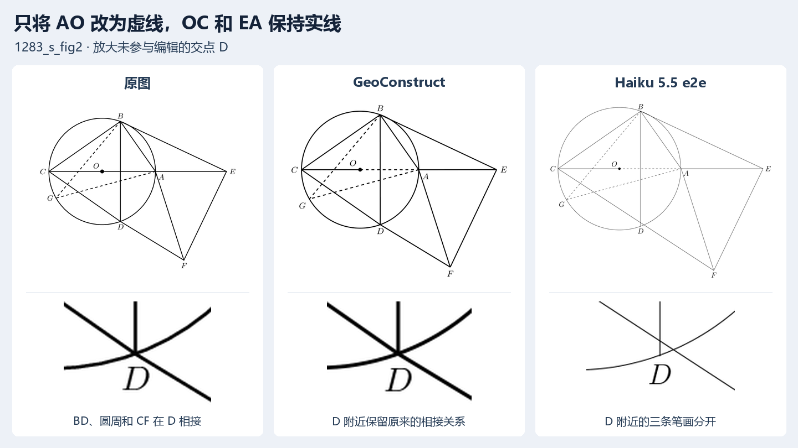

# GeoConstruct 与 Haiku 5.5 的单步线型编辑

同一张图上有一条被多个具名点分隔的实线。指令只要求把中间一段改成虚线，相邻的两段保持实线。按参考图形选择六个新案例，其中五张已有其他虚线，一张的图身为实线。选图和目标段在生成前记录。[任务清单](tasks.json) · [统一提示词](prompt.txt)

GeoConstruct 对归档的 TikZ 执行局部线型操作。Haiku 5.5 接收数据集原图和同一句指令，生成整张图的 TikZ。每例保存原图、两边的代码和运行记录，能编译的结果保存了 PDF 和 PNG。

1283_s_fig2 的两份输出都把 AO 改成虚线，OC 和 EA 也都保持实线。放大后可见，原图及 GeoConstruct 图中的 BD、圆周和 CF 在 D 附近汇合，Haiku 图中这三条笔画分别相交。[原图](03-1283_s_fig2/original.png) · [GeoConstruct 输出](03-1283_s_fig2/ours/edited.png) · [Haiku 输出](03-1283_s_fig2/haiku-5.5/edited.png)

[查看六组完整对照](comparison.png) · [查看逐例核验](scores.json)

按渲染核查，两种方法均在五组中改对目标段和相邻线型。2023_s_fig1 中，GeoConstruct 未能唯一定位待改子段，Haiku 生成的坐标导致 TeX 编译失败。1499_s_fig1 的 Haiku 输出把标签放在独立的显示坐标上，程序无法可靠绑定标签和线端，三段线型由渲染图核验。971_q_fig2 的 C′O 在 TeX 参考中标为虚线，输入位图显示为实线，评分采用位图并记录了修正。
