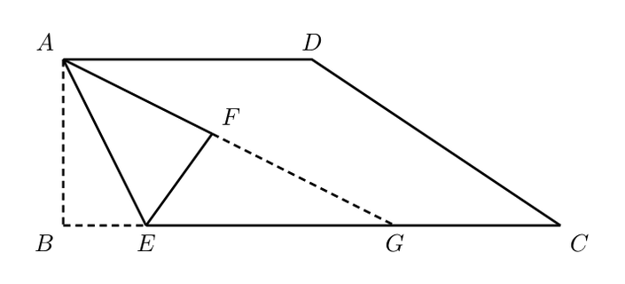

# 1260_q_fig2 修复路由试验

同一归档 v1 与首轮报告开始，各执行至多一次 TikZ 修复。
这是重建状态的单样本回放，非完整端到端重跑，也非等成本对照。未使用 v2 或参考 LaTeX。

| 方案 | 状态 | 编译 | Critic | 必须继续修复 | SSIM | token | 视觉调用 | 秒 |
|---|---|---|---|---|---|---|---|---|
| direct | completed | True | 0.93 | False | 0.9679009766355526 | 16773 | 1 | 32.82 |
| routed | completed | True | 0.93 | False | 0.9686250339297241 | 67266 | 4 | 81.58 |

Critic 为内部启发式评审，SSIM 为现有整图协议，两者均不能替代独立结构标注。
路由组额外消耗诊断、视觉取证和 Geometry 调用，不能据此单次试验宣称优于基线。

## direct

```json
{
  "drawn_labels": [
    "A",
    "B",
    "C",
    "D",
    "E",
    "F",
    "G"
  ],
  "ges_point_labels": [
    "A",
    "B",
    "C",
    "D",
    "E",
    "F"
  ],
  "drawn_labels_without_ges_point": [
    "G"
  ],
  "ges_point_labels_not_drawn": [],
  "point_ids": {
    "C": "point_C",
    "E": "point_E",
    "D": "point_D",
    "A": "point_A",
    "F": "point_F",
    "B": "point_B"
  },
  "limitation": "Math-label extraction is heuristic; no full TikZ semantic parsing."
}
```



## routed

```json
{
  "drawn_labels": [
    "A",
    "B",
    "C",
    "D",
    "E",
    "F",
    "G"
  ],
  "ges_point_labels": [
    "A",
    "B",
    "C",
    "D",
    "E",
    "F",
    "G"
  ],
  "drawn_labels_without_ges_point": [],
  "ges_point_labels_not_drawn": [],
  "point_ids": {
    "C": "point_C",
    "E": "point_E",
    "D": "point_D",
    "A": "point_A",
    "F": "point_F",
    "B": "point_B",
    "G": "point_G"
  },
  "limitation": "Math-label extraction is heuristic; no full TikZ semantic parsing."
}
```


