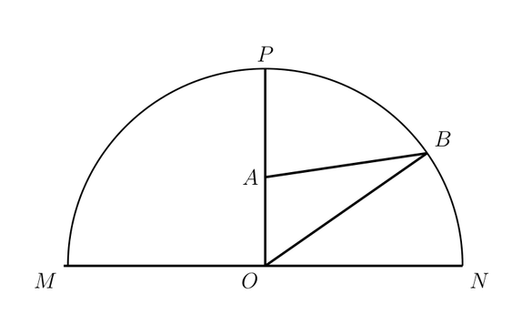
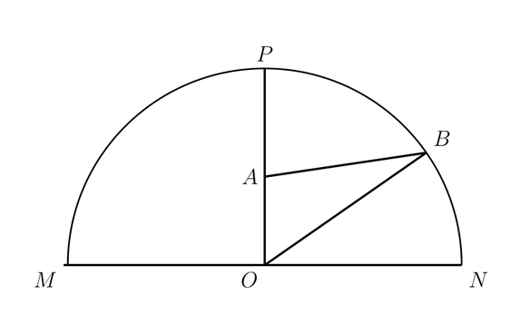

# 3379_q_fig1 修复路由试验

同一归档 v1 与首轮报告开始，各执行至多一次 TikZ 修复。
这是重建状态的单样本回放，非完整端到端重跑，也非等成本对照。未使用 v2 或参考 LaTeX。

| 方案 | 状态 | 编译 | Critic | 必须继续修复 | SSIM | token | 视觉调用 | 秒 |
|---|---|---|---|---|---|---|---|---|
| direct | completed | True | 0.92 | True | 0.9183046840152538 | 15953 | 1 | 31.73 |
| routed | completed | True | 0.9 | False | 0.9188695094966624 | 112098 | 3 | 51.56 |

Critic 为内部启发式评审，SSIM 为现有整图协议，两者均不能替代独立结构标注。
路由组额外消耗诊断、视觉取证和 Geometry 调用，不能据此单次试验宣称优于基线。

## direct

```json
{
  "drawn_labels": [
    "A",
    "B",
    "M",
    "N",
    "O",
    "P"
  ],
  "ges_point_labels": [
    "A",
    "B",
    "N",
    "O",
    "P"
  ],
  "drawn_labels_without_ges_point": [
    "M"
  ],
  "ges_point_labels_not_drawn": [],
  "point_ids": {
    "O": "point_01",
    "B": "point_02",
    "A": "point_03",
    "N": "point_04",
    "P": "point_05"
  },
  "audit_version": "2: point labels or valid bindings/labels_point relations",
  "limitation": "Math-label extraction is heuristic; no full TikZ semantic parsing."
}
```



## routed

```json
{
  "drawn_labels": [
    "A",
    "B",
    "M",
    "N",
    "O",
    "P"
  ],
  "ges_point_labels": [
    "A",
    "B",
    "M",
    "N",
    "O",
    "P"
  ],
  "drawn_labels_without_ges_point": [],
  "ges_point_labels_not_drawn": [],
  "point_ids": {
    "O": "point_01",
    "B": "point_02",
    "A": "point_03",
    "N": "point_04",
    "P": "point_05",
    "M": "point_M"
  },
  "audit_version": "2: point labels or valid bindings/labels_point relations",
  "limitation": "Math-label extraction is heuristic; no full TikZ semantic parsing."
}
```


