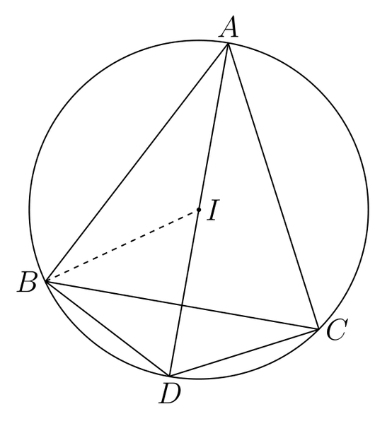

# 6215_s_fig1 修复路由试验

同一归档 v1 与首轮报告开始，各执行至多一次 TikZ 修复。
这是重建状态的单样本回放，非完整端到端重跑，也非等成本对照。未使用 v2 或参考 LaTeX。

| 方案 | 状态 | 编译 | Critic | 必须继续修复 | SSIM | token | 视觉调用 | 秒 |
|---|---|---|---|---|---|---|---|---|
| direct | completed | True | 0.9 | True | 0.8839270743955412 | 38021 | 1 | 86.7 |
| routed | completed | True | 0.92 | True | 0.8839049483318152 | 100328 | 3 | 105.94 |

Critic 为内部启发式评审，SSIM 为现有整图协议，两者均不能替代独立结构标注。
路由组额外消耗诊断、视觉取证和 Geometry 调用，不能据此单次试验宣称优于基线。

## direct

```json
{
  "drawn_labels": [
    "A",
    "B",
    "C",
    "D",
    "I"
  ],
  "ges_point_labels": [
    "A",
    "B",
    "C",
    "D"
  ],
  "drawn_labels_without_ges_point": [
    "I"
  ],
  "ges_point_labels_not_drawn": [],
  "point_ids": {
    "A": "point_01",
    "D": "point_04",
    "B": "point_05",
    "C": "point_06"
  },
  "audit_version": "2: point labels or valid bindings/labels_point relations",
  "limitation": "Math-label extraction is heuristic; no full TikZ semantic parsing."
}
```


## routed

```json
{
  "drawn_labels": [
    "A",
    "B",
    "C",
    "D",
    "I"
  ],
  "ges_point_labels": [
    "A",
    "B",
    "C",
    "D",
    "I"
  ],
  "drawn_labels_without_ges_point": [],
  "ges_point_labels_not_drawn": [],
  "point_ids": {
    "A": "point_01",
    "D": "point_04",
    "B": "point_05",
    "C": "point_06",
    "I": "point_I"
  },
  "audit_version": "2: point labels or valid bindings/labels_point relations",
  "limitation": "Math-label extraction is heuristic; no full TikZ semantic parsing."
}
```


